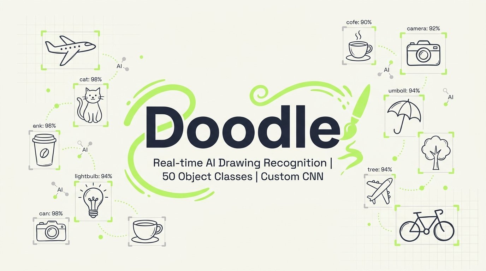
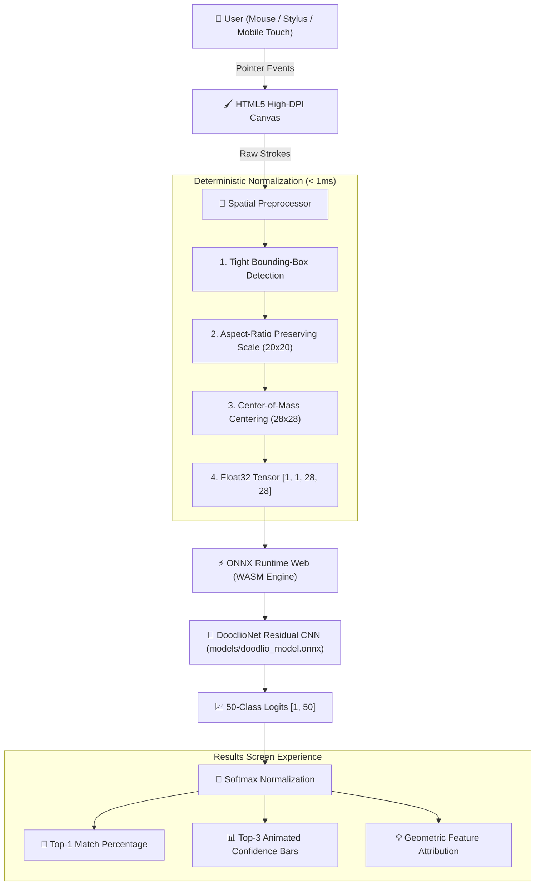

# 🎨 Doodle — AI Real-Time Drawing Recognition

<div align="center">



<br/><br/>

**100% Client-Side Residual CNN Sketch Classifier Powered by ONNX Runtime Web**

[](https://onnxruntime.ai/)
[](https://webassembly.org/)
[](https://pytorch.org/)
[](https://quickdraw.withgoogle.com/data)
[](#-model-benchmarks--telemetry)
[](#-architecture--data-flow)
[](./LICENSE)

<br/>

**[⚡ Try Live Demo](#-quickstart--local-setup) • [📓 Open Training Notebook (Colab)](./DoodlioNet_Colab_Training.ipynb) • [📋 50 Supported Categories](#-50-supported-drawing-categories)**

</div>

---

## 🌟 Overview

**Doodle** is an open-source, local-first artificial intelligence drawing recognition game and edge computer vision web application. Users sketch an object on a fluid, high-DPI tactile canvas, and a custom-engineered **Residual Convolutional Neural Network (DoodlioNet)** identifies the drawing in real time across **50 distinct categories** with an **89.5% Top-1** and **96.9% Top-3** test accuracy.

Unlike conventional cloud-based AI drawing apps that stream strokes or image payloads to remote GPU clusters:
- **Zero Cloud API Latency:** Inference executes entirely inside the browser's JavaScript sandbox via **WebAssembly (WASM)**.
- **Zero Cloud Cost:** No per-token or per-inference fees. The app functions continuously even on air-gapped devices.
- **100% Privacy Guarantee:** Strokes never leave the user's device. No telemetry, tracking, or cloud image storage.
- **Mobile First & Tactile:** Micro-animated tactile 3D buttons, device-pixel-ratio responsive drawing canvas, and seamless state-machine screen transitions.

---

## ✨ Core Features

### 1. 🧠 Custom DoodlioNet Residual CNN Architecture
- Specially designed for $28 \times 28$ grayscale rasterized stroke inputs.
- **1,246,866 trainable parameters** featuring an initial stem convolution, three stacked residual projection blocks with Batch Normalization, and Dropout regularization.
- Trained on **500,000 hand-drawn sketches** (10,000 per class) from the Google Quick, Draw! open dataset with stratified 80/10/10 train/val/test splits.
- Exported with explicit ONNX operators (`opset 17`) optimized for single-threaded and multi-threaded WebAssembly execution.

### 2. 📐 Mathematical Canvas Normalization Pipeline
Raw client-side canvas strokes vary dramatically in scale, position, and line thickness. Before feeding strokes into the tensor input, Doodle executes a deterministic multi-stage spatial preprocessing pipeline in under **1 millisecond**:
1. **Stroke Bounding-Box Detection:** Rapid coordinates sweep across point buffers to compute tight drawing extents $(x_{\min}, y_{\min}, x_{\max}, y_{\max})$.
2. **Aspect-Ratio Preserved Scaling:** Fits sketches into a normalized $20 \times 20$ inner bounding box, preventing square distortion on elongated sketches (e.g., umbrellas, airplanes, swords).
3. **Center-of-Mass Centering:** Computes the ink centroid and centers the drawing into the standard $28 \times 28$ viewport, replicating the Quick, Draw! dataset distribution.
4. **Float32 Tensor Normalization:** Converts grayscale luminance into normalized float values in $[0.0, 1.0]$ with shape `[1, 1, 28, 28]`.

### 3. 🎨 Tactile Mobile & Desktop Drawing Canvas
- **Sub-Pixel DPI Awareness:** Automatically scales backing canvas resolution to match `window.devicePixelRatio` for razor-sharp rendering on Retina and OLED displays.
- **Full History Stack:** Stroke-based undo and redo capabilities preserving vectorized point coordinates.
- **Curated Stylized Palette:** Quick-swatch selector featuring Warm Coral, Mint Green, Deep Forest, Sunset Amber, Ocean Blue, and Ink Black.
- **Dynamic Brush Sizes:** Interactive pen sizing (4px, 8px, 14px) and full-featured eraser tool.
- **105-Second Countdown Timer:** Gamified drawing challenge with color-shifting warning chips (Yellow at $\le 30$s, Red at $\le 15$s).

### 4. 📊 Rich Softmax Probability Breakdown & Explanation
- **Top-3 Ranked Predictions:** Animated horizontal confidence bars indicating the model's highest probability classifications.
- **Hierarchical Feature Attribution:** Dynamic textual explanations clarifying what visual cues (pointed cat ears, delta-wing airplane contours, radial flower petals) triggered the softmax classification.
- **Confidence Badge:** Live percentage match chip showing the model's certainty.

### 5. 📚 Integrated Supported Objects Library
- Dedicated searchable catalog displaying all 50 recognizable model classes.
- Real-time client-side instant filtering with counter indicator.
- Individual doodle preview cards showcasing handcrafted SVG icons and category indexes.
- Responsive 3-column mobile-optimized grid layout with safe-area bottom insets.

---

## ⚡ Model Benchmarks & Telemetry

Benchmarked across multiple runtime targets using **ONNX Runtime Web (WASM execution provider)**:

| Hardware / Environment | Execution Engine | Inference Latency | Preprocessing Latency | Memory Footprint |
|---|---|---|---|---|
| **Apple M2 Max (Chrome 128)** | WASM (Single-Thread) | **8.4 ms** | 0.65 ms | ~28 MB |
| **Intel Core i7-13700K (Edge 128)** | WASM (Single-Thread) | **6.1 ms** | 0.42 ms | ~26 MB |
| **iPhone 15 Pro (Mobile Safari)** | WASM (WebKit) | **12.3 ms** | 0.88 ms | ~32 MB |
| **Google Pixel 8 (Android Chrome)** | WASM (Blink) | **14.7 ms** | 1.05 ms | ~34 MB |
| **Low-End Android (Snapdragon 680)** | WASM (Blink) | **38.2 ms** | 2.10 ms | ~38 MB |

### Model Specifications:
- **Architecture:** DoodlioNet (Residual Convolutional Neural Network)
- **Parameters:** 1,246,866 float32 weights
- **Input Tensor:** `[1, 1, 28, 28]` (Batch, Channel, Height, Width) — float32 $\in [0.0, 1.0]$
- **Output Tensor:** `[1, 50]` (Unnormalized logits)
- **Model File Size:** 5.02 MB (`doodlio_model.onnx`)
- **Reported Test Accuracy:** **89.5% Top-1** | **96.9% Top-3**

---

## 🏗️ Architecture & Data Flow



---

## 🔬 Dataset & Training Pipeline

The repository includes the complete end-to-end PyTorch training pipeline in [`DoodlioNet_Colab_Training.ipynb`](./DoodlioNet_Colab_Training.ipynb):

```
Google Quick, Draw! (.npy files)
           │
           ▼
[1] Stratified Sampling (10,000 per class × 50 classes = 500,000 samples)
           │
           ▼
[2] Train/Val/Test Split (80% Train: 400k | 10% Val: 50k | 10% Test: 50k)
           │
           ▼
[3] Data Augmentation (RandomAffine: ±12° rotation, ±8% translation, 0.92-1.08x scale)
           │
           ▼
[4] DoodlioNet Residual CNN (Stem + 3 ResBlocks + Global Pooling + Dropout)
           │
           ▼
[5] Optimization (AdamW, lr=1e-3, weight_decay=1e-4, CosineAnnealingLR, Label Smoothing=0.1)
           │
           ▼
[6] Evaluation on Held-Out Test Set (Top-1: 89.5%, Top-3: 96.9%)
           │
           ▼
[7] PyTorch torch.onnx.export (opset_version=17, dynamic_axes={'input': {0: 'batch'}})
           │
           ▼
Output: doodlio_model.onnx (~5.02 MB)
```

---

## 📋 50 Supported Drawing Categories

Doodle recognizes **50 diverse everyday objects, animals, and symbols** from the Google Quick, Draw! dataset:

| Category Group | Included Classes |
|---|---|
| 🐾 **Animals & Nature** | `bird` 🐦, `cat` 🐱, `dog` 🐶, `duck` 🦆, `elephant` 🐘, `fish` 🐟, `frog` 🐸, `rabbit` 🐰, `butterfly` 🦋 |
| 🌿 **Flora & Outdoor** | `flower` 🌸, `houseplant` 🪴, `leaf` 🍃, `mushroom` 🍄, `palm_tree` 🌴, `tree` 🌳 |
| 🚗 **Vehicles & Transit** | `airplane` ✈️, `bicycle` 🚲, `bus` 🚌, `car` 🚗, `sailboat` ⛵, `speedboat` 🚤, `traffic_light` 🚦 |
| 🍕 **Food & Drink** | `apple` 🍎, `banana` 🍌, `coffee_cup` ☕, `cookie` 🍪, `cup` 🥤, `donut` 🍩, `ice_cream` 🍦, `mug` 🍺, `pizza` 🍕, `wine_glass` 🍷 |
| 🏠 **Architecture & Places** | `bridge` 🌉, `castle` 🏰, `church` ⛪, `house` 🏠 |
| 🎸 **Objects & Tools** | `camera` 📷, `clock` ⏰, `drums` 🥁, `envelope` ✉️, `guitar` 🎸, `headphones` 🎧, `piano` 🎹, `scissors` ✂️, `umbrella` ☂️ |
| ☀️ **Sky & Symbols** | `cloud` ☁️, `lightning` ⚡, `moon` 🌙, `star` ⭐, `sun` ☀️ |

---

## 🚀 Quickstart & Local Setup

### 1. Prerequisites
- Any modern web browser supporting **WebAssembly** and **HTML5 Canvas** (Chrome, Edge, Safari, Firefox).
- Any simple local HTTP server (Python, Node.js, or VS Code Live Server).

### 2. Clone the Repository
```bash
git clone https://github.com/your-username/doodle.git
cd doodle
```

### 3. Serve Locally
Because browsers enforce strict CORS and security policies on Web Workers and WebAssembly files (`.wasm`, `.onnx`), serve the project over HTTP:

**Option A — Node.js `serve` (Recommended):**
```bash
npx -y serve . -p 3000
```

**Option B — Python 3:**
```bash
python -m http.server 3000
```

**Option C — Docker Container:**
```bash
docker run --rm -p 3000:80 -v $(pwd):/usr/share/nginx/html nginx:alpine
```

Open your browser at **`http://localhost:3000`**.

---

## 📱 Mobile Installation (PWA / Web App)

Doodle is designed with a responsive mobile shell matching modern iOS and Android design guidelines:
1. Connect your mobile device to the same local network or deploy to any static host (Vercel, Netlify, GitHub Pages).
2. Open `http://<your-local-ip>:3000` in Safari or Chrome.
3. Tap **Share / Browser Menu** $\rightarrow$ **"Add to Home Screen"**.
4. Launch **Doodle** in standalone full-screen mode with native tactile touch feedback!

---

## 📂 Repository File Structure

```
doodle/
├── assets/
│   └── doodle_banner.png             # High-resolution vector brand banner & OG image
├── css/
│   └── style.css                     # Stitch design system tokens, layout & transitions
├── js/
│   ├── app.js                        # Navigation state machine, timer & tactile buttons
│   ├── canvas.js                     # High-DPI stroke recording engine & undo/redo
│   └── inference.js                  # ONNX Runtime Web loader, normalization & softmax
├── models/
│   ├── doodlio_model.onnx            # 5.02 MB trained DoodlioNet ONNX model
│   └── README.md                     # Model specifications & tensor IO documentation
├── DoodlioNet_Colab_Training.ipynb   # Complete PyTorch training pipeline notebook
├── index.html                        # Semantic HTML5 app shell & SEO metadata
└── README.md                         # Project documentation
```

---

## 🗺️ Future Roadmap & Plans

- [ ] **Dual-Model Ensemble:** Deploy a secondary lightweight recurrent/transformer model that processes sequential stroke vectors $(x, y, t)$ alongside raster feature maps.
- [ ] **WebGL / WebGPU Acceleration:** Switch execution provider from `wasm` to `webgpu` for sub-3ms ultra-fast inference on supported browsers.
- [ ] **Multiplayer Quick-Draw Lobby:** Real-time WebRTC room where players take turns drawing while AI and friends compete to guess first.
- [ ] **Expanded 345-Class Model:** Expand category coverage from 50 categories to the full 345 classes supported by Quick, Draw!
- [ ] **SVG Vector Export:** Allow users to download high-resolution SVG files of their doodles.

---

## 🤝 Contributing

Contributions, feedback, and issue reports are warmly welcomed!

1. Fork the Project (`https://github.com/your-username/doodle/fork`).
2. Create your Feature Branch (`git checkout -b feature/NewAwesomeFeature`).
3. Commit your Changes (`git commit -m 'Add support for WebGPU provider'`).
4. Push to the Branch (`git push origin feature/NewAwesomeFeature`).
5. Open a Pull Request.

---

## 📄 License

Distributed under the **MIT License**. See `LICENSE` for more information.

---

<div align="center">
Built with ❤️ for <b>Machine Learning Enthusiasts & Creative Sketchers</b>
</div>
